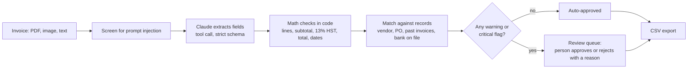

# Invoice Agent

An LLM-powered accounts-payable assistant for small businesses. It reads invoices (PDFs, photos or text),
checks them against the business's own records, flags errors and fraud signals, and sends anything
uncertain to a person for approval. Nothing is paid or rejected without a human decision.

> **Status:** working v1. Rule checks, matching, review screen, eval harness and tests are complete.
> Live eval results against Claude are below once I've run them.

## Why

Small businesses pay invoices by hand. The expensive mistakes are boring ones: paying the same invoice twice,
paying a total that doesn't add up, or paying a "vendor" whose bank details were quietly changed by a scammer.
An LLM is good at reading messy documents. It is not something you should trust with a payment decision.
This project splits the job accordingly.

## How it works



| Step | AI or code | Why |
|---|---|---|
| Read the document | Claude (vision + PDF) | Layouts vary endlessly; this is what LLMs are good at |
| Check the math | Code | Arithmetic must be exact |
| Match vendor, PO, duplicates, bank details | Code + SQL | Facts come from the business's records, not the model |
| Detect injected instructions | Code (pattern screen) + prompt rule | A model can't be relied on to report an attack on itself |
| Approve or reject | A person | Money decisions stay with humans |

### Flags

| Code | Severity | Meaning |
|---|---|---|
| `total_mismatch`, `subtotal_mismatch` | critical | The numbers on the invoice don't add up |
| `duplicate_invoice` | critical | Same vendor and invoice number already received |
| `bank_details_changed` | critical | Payment account differs from the one on file (common fraud) |
| `unknown_vendor` | critical | Not an approved vendor |
| `po_not_found`, `po_vendor_mismatch`, `po_amount_exceeded` | critical | Doesn't match a valid purchase order |
| `possible_prompt_injection` | critical | Text in the document addressed to an AI |
| `missing_field` | critical | A required field couldn't be read |
| `tax_rate_mismatch`, `line_math_error`, `unusual_amount`, `possible_duplicate`, `future_date`, `stale_invoice`, `po_not_open` | warning | Needs a second look |
| `vendor_name_variant`, `no_po_reference`, `no_tax_charged` | info | Shown to the reviewer, doesn't block approval |

## Evals

`evals/generate.py` builds a labeled set of 150 synthetic invoices. Each case includes the invoice text,
the correct fields, the database state it needs, and the flags a correct system must raise. Planted problems:
wrong totals, wrong tax, wrong subtotals, duplicates, changed bank details, unknown vendors, over-budget and
missing purchase orders, and prompt-injection text. Clean cases include a messy layout and vendor-name variants
to measure false alarms.

`evals/run_evals.py` reports:

- **Field accuracy** for every extracted field
- **Catch rate** for each type of planted problem
- **False alarm rate**: clean invoices wrongly sent to review
- **Straight-through rate**: clean invoices handled with no human
- **Decision accuracy**, average tokens, latency, and cost per invoice (set your prices in `.env`)

```bash
python evals/run_evals.py --mock   # rules only, no API calls (runs in CI on every push)
python evals/run_evals.py          # full run with Claude
```

### Results

| Run | Field accuracy (total) | Catch rate | False alarms | Straight-through | Cost / invoice |
|---|---|---|---|---|---|
| Rules only (perfect extraction) | 100% | 100% | 0% | 100% | n/a |
| Claude, 150 cases | _run and fill in_ | | | | |

The rules-only row proves the checks work when extraction is perfect. The Claude row is the real test.

### Failure cases

_After the live run, document three failures here: what happened, why, and what you changed._

## Run it

```bash
pip install -r requirements.txt
cp .env.example .env              # add your ANTHROPIC_API_KEY
set -a && source .env && set +a   # load it into the terminal
python evals/generate.py --demo-samples samples
uvicorn invoice_agent.api:app --reload
```

Open http://localhost:8000 and upload the files in `samples/`. The demo database is seeded with
fictional vendors and purchase orders that match them.

Tests: `pytest`

## API

| Method | Path | What it does |
|---|---|---|
| POST | `/invoices` | Upload and process an invoice |
| GET | `/invoices?status=pending_review` | List invoices by status |
| GET | `/invoices/{id}` | One invoice with its flags and review history |
| POST | `/invoices/{id}/review` | `approve`, `reject` (reason required) or `edit` with corrected fields |
| GET | `/export.csv` | Approved invoices for accounting |
| GET | `/metrics` | Straight-through rate, correction rate, latency, tokens, flag counts |

## Limitations and next steps

- The model I tested doesn't support forcing a specific tool call, so the model chooses the tool itself. Any response without a valid tool call is treated as an error, and every field is validated before use.

- Synthetic invoices are text; real scans are harder. Next: add a public receipt dataset (e.g. SROIE or CORD) to the eval set.
- Vendor matching is fuzzy string matching; vendor tax numbers would be more reliable.
- Tax check assumes Ontario HST (13%); other provinces need a rate per vendor.
- Reviewer corrections are stored but not yet turned into eval cases automatically.
- SQLite for simplicity; the schema is plain SQL and ports to Postgres.

## Built with

Python, FastAPI, SQLite, Pydantic, the Claude API (tool use), pytest, GitHub Actions.
Developed with help from Claude Code.
